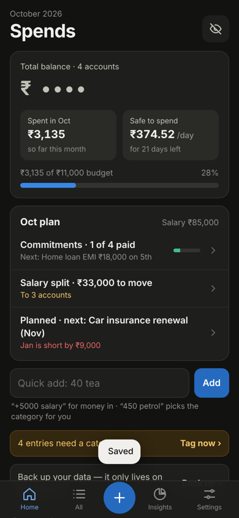
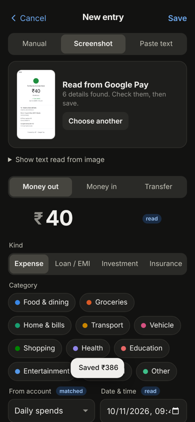
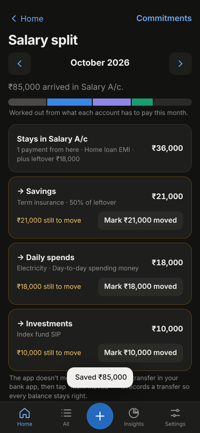
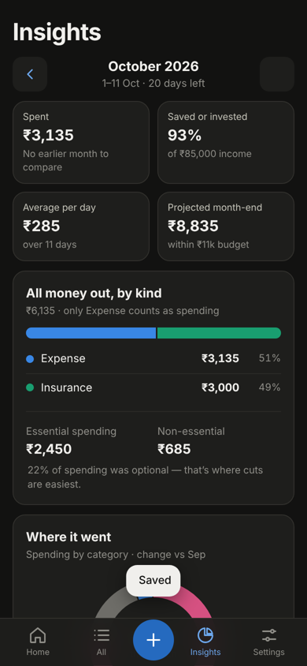

# Spend Tracker

A personal spending tracker that runs as a web app on your iPhone. You don't need the App Store, a developer account, or a server.
Your data stays on your phone and nothing is uploaded.

| Home | Add from screenshot | Salary split | Insights |
|---|---|---|---|
|  |  |  |  |

## What it does

- **Accounts:** you name each account yourself and pick what it's for (Salary, Spending, Savings, Investment, Credit card, Cash, Other). You can have as many of each type as you like. Balances are hidden until you tap the eye.
- **Four ways to add**
  - **Quick add** on Home, e.g. `40 tea`, `450 petrol bike`, `+5000 refund`.
  - **Screenshot** of a GPay, PhonePe, Paytm or bank screen. The text is read on the phone with offline OCR, and the app fills in the amount, payee, note, date, UPI ref and account (matched by its last 4 digits).
  - **Paste** a bank SMS.
  - **Manual** entry.
- **Kinds → Categories → Labels:** only "Expense" kinds count as spending. Loan/EMI, Investment, Insurance and Savings are tracked separately. Labels give sub-types, e.g. Bike → Petrol / Service.
- **Auto-categorise:** the app suggests a category from keywords, from labels, and from what you chose last time for the same payee or UPI ID.
- **Duplicate check:** the app warns you if the same UPI reference has already been saved.
- **Monthly plan**
  - **Commitments:** EMIs, SIPs, insurance and bills, with a tick-off list for each month.
  - **Salary split:** works out how much each account needs this month, based on its commitments, your day-to-day money, the planned-expense set-aside, and an optional % split of whatever is left over.
  - **Planned expenses:** future one-time costs, with a warning like "January is short by ₹9,000" and the monthly set-aside that would fix it.
- **Insights:** spending vs last month (same days), savings rate, average per day, projected month-end vs budget, money out by kind, essential vs non-essential, a category donut with % change, budgets, daily bars, a 6-month trend, habits, a by-label breakdown, and top payees.
- **Backup:** JSON export/restore (replace, or merge in only what's new) and CSV export.
- **Works offline** once installed. It's dark only.

## Put it on your iPhone (one time, about 5 minutes)

1. Create a GitHub repo, e.g. `spend-tracker`, and push this folder:
   ```bash
   cd spend-tracker
   git remote add origin https://github.com/mynkkk7/spend-tracker.git
   git push -u origin main
   ```
2. On GitHub, open **Settings → Pages**, set **Source: Deploy from a branch**, choose **Branch: main / (root)**, and save. After a minute it's live at `https://mynkkk7.github.io/spend-tracker/`.
3. On the iPhone, open that link in **Safari**, then tap **Share → Add to Home Screen**.
4. Always open it from the home-screen icon. iOS gives the icon its own storage, separate from Safari, so opening the link in Safari shows an empty copy.

The repo can be public because it holds only code. Your data never goes to GitHub. `personal/` is git-ignored, so the starter file below stays on your Mac.

## Start with your own categories

`personal/mayank-starter.json` holds your categories (Thumbs Up, Outside food, Home, Car and Bike with Petrol/Service labels, Personal, Study, plus Loan/EMI, Investment, Insurance, Savings and Income ones) with no accounts or entries.

On the first screen, tap **Restore from a backup file**, pick this file (AirDrop it to the phone or put it in iCloud Drive), then add your accounts.

## Updating the app

1. Change the code.
2. Bump `VERSION` in `sw.js`, e.g. `v1.0.1`.
3. Push.

The next time you open the app it shows **"A new version is ready → Update"**. Your data isn't touched.

## Run locally

```bash
npm start            # serves on http://localhost:8080
npm test             # unit tests for parsing and calculations (Node 18+)
```

## How it's built

Plain ES modules with no build step and no framework.

| File | What it does |
|---|---|
| `js/db.js` | IndexedDB wrapper |
| `js/store.js` | In-memory state, CRUD, defaults, backup/restore |
| `js/calc.js` | Pure calculations: balances, month summaries, commitments, salary split, planned projection |
| `js/parse.js` | Quick-add and payment-text parsing, category suggestion |
| `js/ocr.js` | On-device OCR with Tesseract.js 5, vendored under `vendor/tesseract/` |
| `js/charts.js` | Small SVG charts with tap tooltips |
| `js/views/*` | One file per screen |
| `sw.js` | Offline cache |

Money is stored as integer paise, and dates as local `YYYY-MM-DDTHH:mm` strings.

The data model (`Account`, `Kind`, `Category`, `Txn`, `Commitment`, `Planned`, `settings`) is documented by the JSON backup format. That's the contract to keep if this is ever ported to Swift or folded into another app.

## Privacy

There are no analytics, no network calls for your data, and no accounts. Each phone keeps its own separate data, so two people using the same link never see each other's entries.

Third-party code: Tesseract.js and tesseract.js-core (Apache-2.0), with licences in `vendor/tesseract/`.
